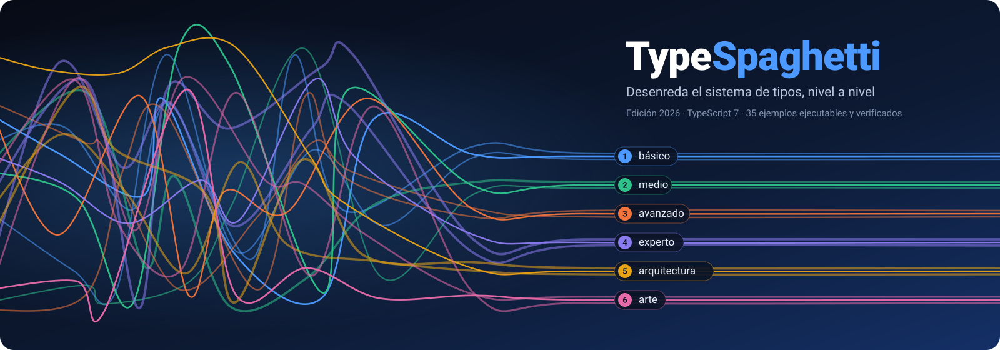

<div align="center">



<p>
  
  
  
  
  
</p>

**Desenreda el sistema de tipos de TypeScript, nivel a nivel: de la primera anotación a la arquitectura de un sistema, con cada ejemplo ejecutado
y cada tipo comprobado por el compilador.**

[Empezar](docs/1-basico.md) · [Los seis niveles](#los-seis-niveles) · [Ejecutar los ejemplos](#ejecutar-los-ejemplos) · [Qué hay de nuevo](#qué-hay-de-nuevo-en-la-edición-2026)

</div>

---

## Por qué «espagueti»

Un tipo espagueti es uno donde todo es opcional, todo es booleano o todo es `any`: **compila siempre y no protege nunca**. Es el código
TypeScript que más abunda, y el que da a TypeScript la fama de ser «JavaScript con más pasos».

```ts
// Espagueti: cualquier combinación compila, incluida «SMS urgente y silenciosa con email»
interface Notificacion { tipo?: string; email?: string; telefono?: string; urgente?: boolean; silenciosa?: boolean; datos?: any }

// Desenredado: cada caso exige exactamente lo suyo, y lo imposible no se puede escribir
type Notificacion =
  | { canal: 'correo'; para: `${string}@${string}`; asunto: string; prioridad: 'silenciosa' | 'normal' | 'urgente' }
  | { canal: 'sms'; para: `+${number}`; prioridad: 'normal' | 'urgente' }
  | { canal: 'webhook'; url: `https://${string}`; carga: Record<string, string | number> };
```

Esta guía enseña a pasar del primero al segundo, en seis niveles, con 35 programas que puedes ejecutar, leer y romper.

---

## Los seis niveles

```mermaid
flowchart LR
    N1["1 · Básico<br/>tipos · funciones<br/>interfaces · clases"] --> N2["2 · Medio<br/>uniones · estrechamiento<br/>genéricos · unknown"]
    N2 --> N3["3 · Avanzado<br/>mapeados · condicionales<br/>plantillas · decoradores"]
    N3 --> N4["4 · Experto<br/>recursión · varianza<br/>marcas · pruebas de tipos"]
    N4 --> N5["5 · Arquitectura<br/>errores · estados · eventos<br/>DI · contratos"]
    N5 --> N6["6 · Arte<br/>legibilidad · mensajes<br/>desenredar · SQL tipado"]
    classDef b fill:#4c9aff,stroke:#2a6fd6,color:#fff
    classDef m fill:#2fc28b,stroke:#1f8f66,color:#fff
    classDef a fill:#f0743c,stroke:#b9501f,color:#fff
    classDef e fill:#8b7bf0,stroke:#5f4fd0,color:#fff
    classDef r fill:#e8a317,stroke:#a8720a,color:#1a1205
    classDef t fill:#e86aa8,stroke:#b8467f,color:#fff
    class N1 b
    class N2 m
    class N3 a
    class N4 e
    class N5 r
    class N6 t
```



| Nivel | Guía | Ejemplos | Aprenderás a… |
|---|---|---|---|
| **1 · Básico** | [docs/1-basico.md](docs/1-basico.md) | [6](ejemplos/1-basico) | Anotar en los bordes y dejar inferir dentro; elegir entre `enum`, unión u objeto `as const` |
| **2 · Medio** | [docs/2-medio.md](docs/2-medio.md) | [6](ejemplos/2-medio) | Pensar los tipos como conjuntos; estrechar; escribir genéricos; validar `unknown` |
| **3 · Avanzado** | [docs/3-avanzado.md](docs/3-avanzado.md) | [7](ejemplos/3-avanzado) | Derivar tipos de los datos; transformar con mapeados, condicionales y plantillas; usar decoradores estándar y `using` |
| **4 · Experto** | [docs/4-experto.md](docs/4-experto.md) | [6](ejemplos/4-experto) | Recursión dentro de los límites, varianza, tipos nominales, pruebas de tipos y lo que queda en ejecución |
| **5 · Arquitectura** 🆕 | [docs/5-arquitectura.md](docs/5-arquitectura.md) | [6](ejemplos/5-arquitectura) | Diseñar con el compilador: errores como valores, estados imposibles, eventos, DI, validación y contratos |
| **6 · Arte** 🆕 | [docs/6-arte.md](docs/6-arte.md) | [4](ejemplos/6-arte) | Tipos que se leen, mensajes de error propios, desenredar el espagueti y SQL tipado |

Cada nivel termina con dos **retos** con su solución, comprobadas con TypeScript 7.0 en modo estricto.

---

## Ejecutar los ejemplos

Requiere **Node 22.18 o posterior**.

```bash
npm install
npm run ejemplos        # compila con TypeScript 7.0, ejecuta los 35 ejemplos y compara su salida
npm run comprobar       # solo comprobar los tipos
npm run portada         # regenerar assets/portada.svg
```

```text
✓ 1-basico/01-tipos-e-inferencia.ts (3)
✓ 1-basico/02-arreglos-y-tuplas.ts (4)
…
✓ 6-arte/04-sql-tipado.ts (3)

35/35 ejemplos correctos · 122 líneas de salida comprobadas · Node v26.13.0
```

### Cómo se lee un ejemplo

Cada archivo de [`ejemplos/`](ejemplos) es un programa completo que se comprueba de tres maneras:

```ts
// 1. Lo que imprime: el verificador compara la salida real con estos comentarios
console.log(formatearId(42));   // → #0042

// 2. Lo que NO compila: si un día compilara, `tsc` fallaría
function _noCompila(): void {
  // @ts-expect-error: un IdUsuario no es un IdPedido, aunque ambos sean string
  cancelar(usuario, correo('a@b.dev'));
}

// 3. Lo que el compilador deduce: igualdad exacta de tipos, comprobada al compilar
type _Pruebas = [Afirmar<Igual<typeof numeros, number[]>>];
```

| Comprobación | Cuántas | Quién la hace |
|---|---|---|
| Líneas de salida `// →` | 122 | [`herramientas/verificar.ts`](herramientas/verificar.ts), tras ejecutar cada ejemplo en Node |
| `// @ts-expect-error` | 40 | `tsc`: falla si la línea compila |
| `Afirmar<Igual<…>>` | 59 | `tsc`: falla si los tipos no son exactamente iguales |

> [!NOTE]
> ¿Por qué `function _noCompila()`? Porque los tipos se borran pero **el código no**: una línea con `@ts-expect-error` en el nivel superior se
> ejecutaría igualmente y alteraría la salida del ejemplo. Envolverla en una función que nunca se llama mantiene la comprobación sin efectos.

Todos los ejemplos compilan además con **TypeScript 6.0** y con la **7.1 beta**, sin cambios.

---

## Qué hay de nuevo en la edición 2026

La primera edición (marzo de 2025) era un único README con 23 fragmentos sueltos. Esta es una reescritura completa:

| | Primera edición | Edición 2026 |
|---|---|---|
| **Formato** | Un README con fragmentos | Seis guías, 35 programas ejecutables y un verificador |
| **Niveles** | 4 | 6: se añaden **arquitectura** y **arte** |
| **Comprobación** | Ninguna: 4 de los 23 fragmentos no compilaban por separado con TypeScript 7.0 | Todo se compila, se ejecuta y se compara en cada cambio |
| **TypeScript** | Sin versión | 7.0, con notas sobre 5.x, 6.0 y la 7.1 beta |
| **Idioma** | Inglés | Español, como el [TypeScript Atlas](https://github.com/CristianSifuentes/TypescriptLabs) |

### Fe de erratas de la primera edición

| Lo que decía | Lo correcto | Dónde se explica |
|---|---|---|
| El ejemplo de «contravarianza» con `honk()` | Eso no es contravarianza; la contravarianza trata de los **parámetros** de las funciones | [Nivel 4 § Varianza](docs/4-experto.md#2-varianza) |
| `@Log(target, key)` como decorador | Es la firma **experimental**: sin `experimentalDecorators` no compila desde la 5.0 (TS1241) | [Nivel 3 § Decoradores](docs/3-avanzado.md#6-decoradores-estándar) |
| «Compila a ES5 si hace falta» | `target: es5` quedó obsoleto en la 6.0 y se retiró en la 7.0 | [Nivel 1](docs/1-basico.md) |
| `func("Hello") // T = string` | Se infiere el literal `"Hello"` | [Nivel 2 § Genéricos](docs/2-medio.md#3-genéricos) |
| `JSONValue` sin arreglos | Un JSON también puede ser una lista | [Nivel 4 § Tipos recursivos](docs/4-experto.md#1-tipos-recursivos) |
| `isNumber(value: any)` | `unknown` obliga a comprobar; `any` desactiva la comprobación | [Nivel 2 § `unknown`](docs/2-medio.md#4-unknown-guardas-y-aserciones) |
| `getArea` sin caso para `Square` | Devolvía `number \| undefined`; ahora es exhaustivo con `never` | [Nivel 2 § Estrechamiento](docs/2-medio.md#2-estrechamiento) |
| Decoradores como «experimentales de Angular/NestJS» | Desde la 5.0 hay decoradores estándar; en mayo de 2026 la propuesta volvió a stage 2.7 | [Nivel 3 § Decoradores](docs/3-avanzado.md#6-decoradores-estándar) |

---

## TypeScript en noviembre de 2026, en una tabla

| | |
|---|---|
| **Versión estable** | 7.0.2: el compilador portado a Go, entre 8 y 12 veces más rápido |
| **En beta** | 7.1: API estable, *content mappers* y `es2026` por defecto |
| **Puente** | 6.0: `strict`, `module: esnext` y `types: []` por defecto; ES5, AMD y `baseUrl`, obsoletos |
| **Ejecutar `.ts` directamente** | Node 22.18+ borra los tipos; `erasableSyntaxOnly` asegura que se pueda |
| **Decoradores** | Dos sistemas: los experimentales (Angular, NestJS) y los estándar, en stage 2.7 |
| **`using`** | Stage 4 desde mayo de 2026: formará parte de ES2027 |

La historia completa, versión a versión y verificada contra 52 compiladores reales, está en el
**[TypeScript Atlas](https://github.com/CristianSifuentes/TypescriptLabs)**, el repositorio hermano de esta guía.

---

## Estructura

```text
TypeSpaghetti/
├── README.md
├── docs/                  las seis guías, con diagramas y retos
│   ├── 1-basico.md  ·  2-medio.md  ·  3-avanzado.md
│   └── 4-experto.md  ·  5-arquitectura.md  ·  6-arte.md
├── ejemplos/              35 programas ejecutables, uno por tema
│   ├── _comun/pruebas-de-tipos.ts     Igual<A, B> y Afirmar<T>
│   ├── 1-basico/ … 6-arte/
├── herramientas/
│   ├── verificar.ts       ejecuta los ejemplos y compara su salida
│   └── generar-portada.ts dibuja assets/portada.svg
├── assets/portada.svg
├── tsconfig.json          estricto, con las opciones recomendadas en 2026
└── package.json           TypeScript ~7.0.2
```

---

## Licencia

[Apache 2.0](LICENSE).
