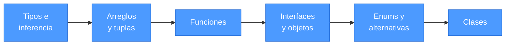

<div align="center">

# Nivel 1 · Básico

**Tipos, inferencia, arreglos, tuplas, funciones, interfaces, enums y clases: el vocabulario con el que se escribe todo lo demás**

[🏠 Inicio](../README.md) · [Nivel 2 · Medio ➡](2-medio.md)

</div>

> [!IMPORTANT]
> El objetivo de este nivel no es memorizar sintaxis, sino adquirir **un reflejo**: anotar en los bordes (lo que entra y sale de una función, lo
> que se exporta) y dejar que la inferencia trabaje dentro. Un código TypeScript bien escrito tiene pocas anotaciones, y todas en su sitio.

| | |
|---|---|
| **Ejemplos** | 6 archivos en [`ejemplos/1-basico/`](../ejemplos/1-basico) |
| **Requisitos** | Saber JavaScript moderno: `const`/`let`, funciones flecha, clases, módulos |
| **Al terminar sabrás** | Leer y escribir firmas, modelar objetos con interfaces y elegir entre `enum`, unión u objeto `as const` |

---

## Mapa del nivel



---

## 1. Tipos e inferencia

📄 [`01-tipos-e-inferencia.ts`](../ejemplos/1-basico/01-tipos-e-inferencia.ts)

TypeScript deduce el tipo de casi todo lo que asignas. La regla que más conviene interiorizar es cómo trata los literales:

```ts
let titulo = 'TypeSpaghetti';   // string: un `let` puede cambiar, así que se ensancha
const edicion = 2026;           // 2026: un `const` no cambia, así que conserva el literal
```

| Tipo | Valores | Notas |
|---|---|---|
| `string` · `number` · `boolean` | Los primitivos de siempre | `number` incluye `NaN` e `Infinity` |
| `bigint` | `9007199254740993n` | Enteros de precisión arbitraria |
| `symbol` | `Symbol('id')` | Identificadores únicos |
| `null` · `undefined` | Ausencia de valor | Con `strict` (por defecto desde TypeScript 6.0) son tipos propios |
| `any` | Cualquier cosa, **sin comprobar** | Apaga el compilador: evítalo |
| `unknown` | Cualquier cosa, **comprobando antes de usar** | La forma segura de decir «no sé qué es» |
| `never` | Ningún valor | Lo imposible: funciones que nunca vuelven, ramas inalcanzables |

> [!TIP]
> **`unknown` en vez de `any`.** Ambos aceptan cualquier valor, pero `unknown` te obliga a comprobar qué es antes de usarlo. Todo lo que llega de
> fuera —`JSON.parse`, `fetch`, un formulario— debería empezar siendo `unknown`. El [nivel 2](2-medio.md#4-unknown-guardas-y-aserciones) enseña a
> convertirlo en algo útil.

---

## 2. Arreglos y tuplas

📄 [`02-arreglos-y-tuplas.ts`](../ejemplos/1-basico/02-arreglos-y-tuplas.ts)

```ts
const versiones: readonly number[] = [5.9, 6.0, 7.0];   // sin push, pop ni sort in situ
type Rango = [inicio: number, fin: number];              // tupla con nombres (4.0)
type Pixel = [x: number, y: number, color?: string];     // con un elemento opcional

const primero = lenguajes[0];   // string | undefined, con noUncheckedIndexedAccess
```

- **Arreglo** (`T[]`): longitud variable, todos los elementos del mismo tipo.
- **Tupla** (`[A, B]`): longitud fija, cada posición con su tipo. Ideal para devolver varios valores.
- **`readonly`** en el tipo impide modificar la lista por accidente; para copias ordenadas existen `toSorted`, `toReversed` y `with` (ES2023).

> [!NOTE]
> El `tsconfig.json` de este repositorio activa `noUncheckedIndexedAccess`: leer `arreglo[i]` da `T | undefined`, porque un índice puede no
> existir. No forma parte de `strict`, pero el `tsc --init` de TypeScript 5.9 y 7.0 la activa: es la opción que más errores reales evita fuera del
> paquete estricto.

---

## 3. Funciones

📄 [`03-funciones.ts`](../ejemplos/1-basico/03-funciones.ts)

```ts
function saludar(nombre: string, saludo = 'Hola', ...titulos: string[]): string { … }

type Operacion = (a: number, b: number) => number;
const operaciones: Record<'suma' | 'producto', Operacion> = {
  suma: sumar,
  producto: (a, b) => a * b,   // a y b se infieren por el contexto
};

function analizar(entrada: string): number;      // sobrecargas: el retorno
function analizar(entrada: string[]): number[];  // depende del argumento
```

| Construcción | Para qué |
|---|---|
| `param?: T` · `param = valor` | Parámetros opcionales y con valor por defecto |
| `...resto: T[]` | Número variable de argumentos |
| `(a: A) => R` | El tipo de una función, para *callbacks* y propiedades |
| Sobrecargas | Dos o tres combinaciones de entrada con salidas distintas |
| `: void` | «No importa lo que devuelva» |
| `: never` | «Nunca devuelve»: lanza siempre o no termina |

---

## 4. Interfaces y objetos

📄 [`04-interfaces-y-objetos.ts`](../ejemplos/1-basico/04-interfaces-y-objetos.ts)

```ts
interface Usuario {
  readonly id: number;   // se fija al crear
  nombre: string;
  correo?: string;       // puede faltar
}
interface Administrador extends Usuario {
  permisos: readonly ('leer' | 'escribir' | 'borrar')[];
}
```

Tres ideas que explican casi todos los errores de este tema:

1. **Tipado estructural.** Lo que importa es la forma, no el nombre: cualquier objeto con `id` y `nombre` sirve como `Usuario`, aunque nunca lo
   declare. Es lo que permite tipar JavaScript tal como se escribe.
2. **Los literales frescos se comprueban a fondo.** `const u: Usuario = { id: 1, nombe: 'Ada' }` es un error (TS2561: «¿quisiste decir
   `nombre`?»). Un objeto que llega desde otra variable, en cambio, puede traer propiedades de más.
3. **Opcional no es lo mismo que `undefined`.** Con `exactOptionalPropertyTypes` (activado aquí), `correo?: string` acepta que falte, pero no
   `correo: undefined`.

> [!TIP]
> ¿`interface` o `type`? Para formas de objetos, `interface`: se extiende con `extends`, el compilador la cachea y los mensajes de error muestran
> su nombre. Para uniones, tuplas y tipos calculados, `type`. La comparación completa está en el
> [atlas, capítulo 21](https://github.com/CristianSifuentes/TypescriptLabs/blob/master/docs/21-guias-de-decision.md#1-interface-o-type).

---

## 5. Enums y sus alternativas

📄 [`05-enums-y-alternativas.ts`](../ejemplos/1-basico/05-enums-y-alternativas.ts)

```ts
enum CodigoHttp { Ok = 200, NoEncontrado = 404 }          // emite un objeto (con mapeo inverso)
type Metodo = 'GET' | 'POST' | 'PUT' | 'DELETE';          // no emite nada

const Estado = { Borrador: 'borrador', Publicado: 'publicado' } as const;
type Estado = (typeof Estado)[keyof typeof Estado];       // 'borrador' | 'publicado'
```

| | `enum` | Unión de literales | Objeto `as const` |
|---|---|---|---|
| ¿Genera JavaScript? | Sí | No | Sí, un objeto normal |
| ¿Funciona con `node archivo.ts` (eliminación de tipos)? | ❌ | ✅ | ✅ |
| ¿Se puede recorrer en ejecución? | Sí (con matices) | No | Sí |
| ¿Acepta el literal `'borrador'` directamente? | No | Sí | Sí |

> [!NOTE]
> **Novedad de la edición 2026.** La primera edición presentaba `enum` como la forma natural de modelar opciones. Hoy Node 22.18+ ejecuta archivos
> `.ts` borrando los tipos, y un `enum` no se puede borrar porque genera código: la opción `erasableSyntaxOnly` (TypeScript 5.8) lo prohíbe. En
> código nuevo, preferimos el objeto `as const` o la unión de literales.

---

## 6. Clases

📄 [`06-clases.ts`](../ejemplos/1-basico/06-clases.ts)

```ts
abstract class Figura {
  static #creadas = 0;                    // privado de verdad (ES2022)
  constructor(readonly nombre: string) {}  // propiedad de parámetro
  abstract area(): number;
}

class Circulo extends Figura {
  #radio: number;
  get radio(): number { return this.#radio; }
  set radio(valor: number) { /* valida */ }
  override area(): number { return Math.PI * this.#radio ** 2; }
}
```

| Elemento | Qué aporta |
|---|---|
| `#campo` | Privacidad real: no aparece en `JSON.stringify` ni con `as any` |
| `private campo` | Privacidad solo para el compilador (la de 2012) |
| `readonly` | Se asigna en la declaración o en el constructor, y ya no cambia |
| `abstract` | Clases que no se instancian y métodos que las subclases deben implementar |
| `override` | Declara que sobrescribes; con `noImplicitOverride` (activado aquí) es obligatorio |
| `get` / `set` | Accesores con validación |

---

## Retos

<details>
<summary><b>Reto 1.</b> Tipa <code>rango(inicio, fin?)</code>, que devuelve «2026-03-23 → 2026-07-08» o solo la fecha de inicio si no hay fin.</summary>

```ts
function rango(inicio: Date, fin?: Date): string {
  const dia = (d: Date) => d.toISOString().slice(0, 10);
  return fin ? `${dia(inicio)} → ${dia(fin)}` : dia(inicio);
}
```

</details>

<details>
<summary><b>Reto 2.</b> Define <code>Libro</code>: ISBN de solo lectura, título, páginas opcionales y <b>al menos un autor</b>.</summary>

```ts
interface Libro {
  readonly isbn: string;
  titulo: string;
  autores: [string, ...string[]];   // tupla con un elemento obligatorio y el resto opcional
  paginas?: number;
}
// const malo: Libro = { isbn: '1', titulo: 'x', autores: [] };   // error: falta el primer autor
```

</details>

---

<div align="center">

[🏠 Inicio](../README.md) · [Nivel 2 · Medio ➡](2-medio.md)

</div>
