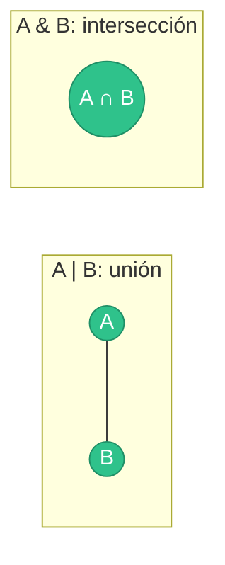

<div align="center">

# Nivel 2 · Medio

**Uniones, intersecciones, estrechamiento, genéricos, `unknown`, `satisfies` y `null`: cómo hacer que el compilador entienda lo que tu código ya sabe**

[⬅ Nivel 1 · Básico](1-basico.md) · [🏠 Inicio](../README.md) · [Nivel 3 · Avanzado ➡](3-avanzado.md)

</div>

> [!IMPORTANT]
> El salto de este nivel es dejar de pensar en los tipos como etiquetas y empezar a pensarlos como **conjuntos de valores**. Una unión amplía el
> conjunto; una comprobación en tu código lo reduce, y el compilador sigue esa reducción línea a línea. Casi todo lo que hace TypeScript por ti
> ocurre aquí.

| | |
|---|---|
| **Ejemplos** | 6 archivos en [`ejemplos/2-medio/`](../ejemplos/2-medio) |
| **Al terminar sabrás** | Modelar alternativas con uniones discriminadas, escribir funciones genéricas y validar datos externos |

---

## Mapa del nivel


---

## 1. Uniones e intersecciones

📄 [`01-uniones-e-intersecciones.ts`](../ejemplos/2-medio/01-uniones-e-intersecciones.ts)



| Operación | Significa | Ejemplo | Resultado |
|---|---|---|---|
| `A \| B` | Uno de los dos | `string \| number` | Solo puedes usar lo común, hasta estrechar |
| `A & B` | Los dos a la vez | `{ id } & { nombre }` | Un objeto con ambas propiedades |
| Primitivos incompatibles | Conjunto vacío | `string & number` | `never` |
| `keyof (A \| B)` | Claves **comunes** | — | Menos claves |
| `keyof (A & B)` | **Todas** las claves | — | Más claves |

---

## 2. Estrechamiento

📄 [`02-estrechamiento.ts`](../ejemplos/2-medio/02-estrechamiento.ts)

El compilador sigue el flujo de tu código y reduce el tipo de una variable según las comprobaciones que haces:

```ts
type Forma =
  | { tipo: 'circulo'; radio: number }
  | { tipo: 'cuadrado'; lado: number }
  | { tipo: 'triangulo'; base: number; altura: number };

function area(forma: Forma): number {
  switch (forma.tipo) {                 // `tipo` es el discriminante
    case 'circulo': return Math.PI * forma.radio ** 2;
    case 'cuadrado': return forma.lado ** 2;
    case 'triangulo': return (forma.base * forma.altura) / 2;
    default: {
      const exhaustivo: never = forma;  // si mañana añades una forma, esto deja de compilar
      return exhaustivo;
    }
  }
}
```

| Herramienta | Ejemplo | Desde |
|---|---|---|
| `typeof` · `instanceof` | `typeof x === 'string'` | 1.4 |
| Guardas propias | `function esPez(a): a is Pez` | 1.6 |
| Uniones discriminadas | `switch (forma.tipo)` | 2.0 |
| `in` | `'nadar' in animal` | 2.7 |
| Condiciones guardadas en constantes | `const esTexto = typeof x === 'string'` | 4.4 |
| Desestructurar una unión discriminada | `const { tipo, dato } = accion` | 4.6 |
| `switch (true)` | `case typeof x === 'string':` | 5.3 |
| Clausuras tras la última asignación | `url` dentro de un `map` | 5.4 |
| **Predicados inferidos** | `lista.filter(x => x !== undefined)` ya estrecha | 5.5 |

> [!TIP]
> La comprobación exhaustiva con `never` es una de las técnicas más rentables de TypeScript: convierte «olvidé tratar el caso nuevo» en un error
> de compilación. Volverás a verla en el [nivel 5](5-arquitectura.md), aplicada a errores y a máquinas de estados.

---

## 3. Genéricos

📄 [`03-genericos.ts`](../ejemplos/2-medio/03-genericos.ts)

```ts
function propiedad<T, K extends keyof T>(objeto: T, clave: K): T[K] {
  return objeto[clave];
}
const puerto = propiedad({ puerto: 8080, host: 'localhost' }, 'puerto');   // number

function rutas<const T extends readonly string[]>(lista: T): T { … }       // literales exactos (5.0)
function elegir<C extends string>(opciones: readonly C[], porDefecto: NoInfer<C>): C { … }   // 5.4
```

| Patrón | Significa |
|---|---|
| `<T>` | Cualquier tipo, fijado en cada llamada |
| `<T extends U>` | Cualquier subtipo de `U`: puedes usar lo que `U` garantiza |
| `<K extends keyof T>` | Una clave de `T`; el retorno `T[K]` es el tipo exacto de esa propiedad |
| `<T = Defecto>` | Valor por defecto (2.3) |
| `<const T>` | Inferir literales, como si quien llama escribiera `as const` (5.0) |
| `NoInfer<T>` | Esta posición no participa en la inferencia (5.4) |

> [!NOTE]
> **Corrección de la primera edición.** Decía que en `func("Hello")` se infiere `T = string`. Con `T extends string | number`, se infiere el
> **literal** `"Hello"`: las restricciones con primitivos conservan los literales. Es lo que permite que `identidad('hola')` devuelva el tipo
> `'hola'`.

---

## 4. `unknown`, guardas y aserciones

📄 [`04-unknown-y-guardas.ts`](../ejemplos/2-medio/04-unknown-y-guardas.ts)

```ts
function esProducto(x: unknown): x is Producto {           // guarda: devuelve boolean
  return typeof x === 'object' && x !== null && 'sku' in x && typeof x.sku === 'string' && …;
}

function afirmarProducto(x: unknown): asserts x is Producto {   // aserción (3.7): lanza o demuestra
  if (!esProducto(x)) throw new TypeError(…);
}
```

| | Guarda (`x is T`) | Aserción (`asserts x is T`) |
|---|---|---|
| Devuelve | `boolean` | Nada, o lanza |
| Se usa con | `if`, `filter`, ternarios | Una sentencia suelta |
| Ideal para | Ramificar | Validar precondiciones |

Desde la 4.9, `'sku' in x` añade la propiedad al tipo aunque no estuviera declarada, y por eso la guarda de arriba no necesita un solo `as`. Para
esquemas grandes, el [nivel 5](5-arquitectura.md#5-validar-en-el-borde) construye un validador del que se deduce el tipo.

---

## 5. `satisfies` y `as const`

📄 [`05-satisfies-y-as-const.ts`](../ejemplos/2-medio/05-satisfies-y-as-const.ts)

| Escribes | Se comprueba | El tipo resultante |
|---|---|---|
| `const x: T = v` | ✅ | `T`: se pierden los detalles |
| `const x = v as T` | Casi nada | `T` |
| `const x = v satisfies T` (4.9) | ✅ | **El de `v`**: se conservan las claves y los literales |
| `const x = v as const satisfies T` | ✅ | El de `v`, inmutable y con literales |

```ts
const tema = {
  fondo: '#101820',
  texto: [242, 170, 76],
} satisfies Record<string, Color>;

tema.fondo.toUpperCase();   // `fondo` sigue siendo string; con una anotación sería `Color` y habría que estrechar
```

---

## 6. `null`, `undefined` y lo opcional

📄 [`06-nulos-y-opcionales.ts`](../ejemplos/2-medio/06-nulos-y-opcionales.ts)

```ts
const comoLlamarle = p.apodo ?? p.nombre;                    // ?? solo sustituye null y undefined
const ciudad = p.direccion?.ciudad ?? 'ciudad desconocida';  // ?. se detiene si falta algo
(cache.datos ??= []).push('primero');                        // inicializar solo si falta
```

| Operador | Se detiene o sustituye con… | Trampa que evita |
|---|---|---|
| `a?.b` | `null` o `undefined` | `a && a.b` también se detiene con `0` y `''` |
| `a ?? b` | `null` o `undefined` | `a \|\| b` también sustituye `0`, `''` y `false` |
| `a ??= b` | `null` o `undefined` | Inicialización perezosa |

El ejemplo lo demuestra: con `volumen: 0`, `volumen || 50` da 50 y `volumen ?? 50` da 0.

---

## Retos

<details>
<summary><b>Reto 1.</b> Escribe <code>primero(lista)</code>, que devuelva el primer elemento con su tipo exacto o <code>undefined</code>.</summary>

```ts
function primero<T>(lista: readonly T[]): T | undefined {
  return lista[0];
}
const p = primero(['a', 'b']);   // string | undefined
```

</details>

<details>
<summary><b>Reto 2.</b> Escribe una guarda <code>esFecha</code> que rechace también las fechas inválidas (<code>new Date('x')</code>).</summary>

```ts
function esFecha(x: unknown): x is Date {
  return x instanceof Date && !Number.isNaN(x.getTime());
}
```

</details>

---

<div align="center">

[⬅ Nivel 1 · Básico](1-basico.md) · [🏠 Inicio](../README.md) · [Nivel 3 · Avanzado ➡](3-avanzado.md)

</div>
