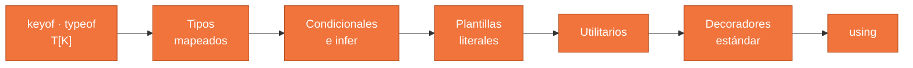

<div align="center">

# Nivel 3 · Avanzado

**`keyof` y `typeof`, tipos mapeados, condicionales, `infer`, plantillas literales, utilitarios, decoradores estándar y `using`: tipos que se calculan a partir de otros tipos**

[⬅ Nivel 2 · Medio](2-medio.md) · [🏠 Inicio](../README.md) · [Nivel 4 · Experto ➡](4-experto.md)

</div>

> [!IMPORTANT]
> En este nivel el sistema de tipos se convierte en un **lenguaje de programación**: tiene variables (alias), funciones (genéricos), bucles (tipos
> mapeados), condicionales (`extends ? :`) y manipulación de cadenas (plantillas literales). La regla para usarlo bien: **escribe los datos una vez y
> deriva los tipos de ellos**, en lugar de mantener dos copias que acaban divergiendo.

| | |
|---|---|
| **Ejemplos** | 7 archivos en [`ejemplos/3-avanzado/`](../ejemplos/3-avanzado) |
| **Al terminar sabrás** | Derivar tipos de valores, transformar tipos con mapeados y condicionales, y usar decoradores y `using` como en 2026 |

---

## Mapa del nivel



| En JavaScript (valores) | En TypeScript (tipos) |
|---|---|
| `Object.keys(o)` | `keyof O` |
| `o[k]` | `O[K]` |
| `for (const k in o)` | `{ [K in keyof O]: … }` |
| `cond ? a : b` | `A extends B ? X : Y` |
| Desestructurar | `infer` |
| `` `${a}-${b}` `` | `` `${A}-${B}` `` |

---

## 1. `keyof`, `typeof` y accesos indexados

📄 [`01-keyof-typeof-e-indices.ts`](../ejemplos/3-avanzado/01-keyof-typeof-e-indices.ts)

```ts
const PLANES = {
  gratis: { precio: 0, soporte: 'comunidad' },
  pro: { precio: 12, soporte: 'correo' },
} as const;

type NombrePlan = keyof typeof PLANES;                         // 'gratis' | 'pro'
type Soporte = (typeof PLANES)[NombrePlan]['soporte'];         // 'comunidad' | 'correo'

const ROLES = ['lector', 'editor', 'admin'] as const;
type Rol = (typeof ROLES)[number];                             // 'lector' | 'editor' | 'admin'
```

Añadir un plan nuevo al objeto actualiza todos los tipos derivados. Esa es la idea de «una sola fuente de verdad».

---

## 2. Tipos mapeados

📄 [`02-tipos-mapeados.ts`](../ejemplos/3-avanzado/02-tipos-mapeados.ts)

```ts
type Editable<T> = { -readonly [K in keyof T]: T[K] };                                  // quitar readonly
type Getters<T> = { [K in keyof T as `get${Capitalize<K & string>}`]: () => T[K] };     // renombrar (4.1)
type DeTipo<T, V> = { [K in keyof T as T[K] extends V ? K : never]: T[K] };              // filtrar
type Cambios<T> = { [K in keyof T]: { campo: K; valor: T[K] } }[keyof T];               // objeto → unión
```

El último patrón —mapear y luego indexar con `[keyof T]`— convierte un objeto en una **unión de casos** y aparece en todas partes: eventos,
acciones de un *reducer* o mensajes entre procesos.

---

## 3. Condicionales e `infer`

📄 [`03-condicionales-e-infer.ts`](../ejemplos/3-avanzado/03-condicionales-e-infer.ts)

```ts
type Elemento<T> = T extends readonly (infer E)[] ? E : T;
type Desenvolver<T> = T extends Promise<infer V> ? Desenvolver<V> : T;
type ANumero<S> = S extends `${infer N extends number}` ? N : never;   // '42' → 42 (4.8)
```

| Comportamiento | Ejemplo | Resultado |
|---|---|---|
| Se reparte sobre uniones | `ALista<string \| number>` | `string[] \| number[]` |
| Envolver en `[]` lo evita | `[T] extends [unknown] ? T[] : never` | `(string \| number)[]` |
| Filtrar uniones | `T extends null \| undefined ? never : T` | Así están hechos `Exclude` y `NonNullable` |

---

## 4. Plantillas literales

📄 [`04-plantillas-literales.ts`](../ejemplos/3-avanzado/04-plantillas-literales.ts)

```ts
type Manejador = `on${Capitalize<'click' | 'foco'>}`;     // 'onClick' | 'onFoco'
type Css = `${number}${'px' | 'rem' | '%'}`;

type Parametros<R extends string> =
  R extends `${string}:${infer P}/${infer Resto}` ? P | Parametros<`/${Resto}`>
  : R extends `${string}:${infer P}` ? P
  : never;

enlazar('/usuarios/:id/pedidos/:pedido', { id: 7, pedido: 'A-42' });   // falta un parámetro → error de compilación
```

> [!WARNING]
> Las plantillas con uniones generan el **producto cartesiano**: tres tallas por dos tonos dan seis combinaciones; diez por diez por diez, mil. El
> compilador se niega por encima de 100 000 miembros (TS2590).

---

## 5. Utilitarios

📄 [`05-utilitarios.ts`](../ejemplos/3-avanzado/05-utilitarios.ts)

| Utilitario | Para qué | Desde |
|---|---|---|
| `Partial` · `Required` · `Readonly` | Cambiar los modificadores de todas las propiedades | 2.1 · 2.8 · 2.1 |
| `Pick` · `Omit` | Quedarse con algunas propiedades o quitarlas | 2.1 · 3.5 |
| `Record<K, V>` | Diccionarios | 2.1 |
| `Exclude` · `Extract` · `NonNullable` | Filtrar uniones | 2.8 |
| `ReturnType` · `Parameters` · `InstanceType` | Extraer de funciones y clases | 2.8 · 3.1 · 2.8 |
| `Awaited` | Desenvolver promesas | 4.5 |
| `NoInfer` | Excluir una posición de la inferencia | 5.4 |

```ts
type NuevaTarea = Omit<Tarea, 'id'>;
type CambiosDeTarea = Partial<Pick<Tarea, 'titulo' | 'hecha'>>;
type Creada = Awaited<ReturnType<Repositorio['crear']>>;   // Tarea
```

---

## 6. Decoradores estándar

📄 [`06-decoradores-estandar.ts`](../ejemplos/3-avanzado/06-decoradores-estandar.ts)

```ts
class Termostato {
  @enRango(10, 30) accessor objetivo = 21;   // valida cada escritura
  @medir ajustar(delta: number): number { … }
  @enlazado leer(): string { … }             // se puede pasar suelto sin perder `this`
}
```

| | Experimentales (2015) | Estándar (TypeScript 5.0) |
|---|---|---|
| Se activan con | `experimentalDecorators: true` | Nada: son los que se aplican por defecto |
| Firma de un decorador de método | `(objetivo, clave, descriptor)` | `(metodo, contexto)` |
| Decoradores de parámetro | Sí | No |
| Los usan | Angular, NestJS, TypeORM | Lit, MobX 6 y código nuevo |

> [!NOTE]
> **Corrección de la primera edición.** El decorador `Log(target, key)` de la versión anterior usa la firma **experimental**: con TypeScript 5.0 o
> posterior y sin `experimentalDecorators`, no compila (TS1241). Y un matiz de 2026: en mayo, TC39 devolvió la propuesta de decoradores a
> **stage 2.7**. Funcionan, TypeScript los transforma, pero ningún motor de JavaScript los implementa todavía y no se pueden ejecutar borrando tipos.

---

## 7. `using`: recursos que se liberan solos

📄 [`07-using-y-recursos.ts`](../ejemplos/3-avanzado/07-using-y-recursos.ts)

```ts
function informe(): string {
  using principal = new Conexion('principal');
  using replica = new Conexion('réplica');
  return …;
}   // aquí se cierra la réplica y después la principal, aunque haya excepciones
```

`using` (TypeScript 5.2) llama a `[Symbol.dispose]()` al salir del bloque, en orden inverso. Llegó a **stage 4 en mayo de 2026** y formará parte de
ES2027. `DisposableStack` agrupa limpiezas de cosas que no implementan el protocolo, como un `setInterval`.

---

## Retos

<details>
<summary><b>Reto 1.</b> Escribe <code>Nulables&lt;T&gt;</code>: cada propiedad admite además <code>null</code>, conservando las opcionales.</summary>

```ts
type Nulables<T> = { [K in keyof T]: T[K] | null };
// Nulables<{ a: number; b?: string }>  →  { a: number | null; b?: string | null }
```

Funciona con las opcionales porque `keyof T` sobre un tipo existente produce un mapeado **homomórfico**, que conserva los modificadores.

</details>

<details>
<summary><b>Reto 2.</b> Escribe <code>SinPrefijo&lt;S, P&gt;</code>: quita un prefijo de cada miembro de una unión de cadenas si lo tiene.</summary>

```ts
type SinPrefijo<S, P extends string> = S extends `${P}${infer R}` ? R : S;
// SinPrefijo<'on-click' | 'on-foco' | 'otro', 'on-'>  →  'click' | 'foco' | 'otro'
```

</details>

---

<div align="center">

[⬅ Nivel 2 · Medio](2-medio.md) · [🏠 Inicio](../README.md) · [Nivel 4 · Experto ➡](4-experto.md)

</div>
