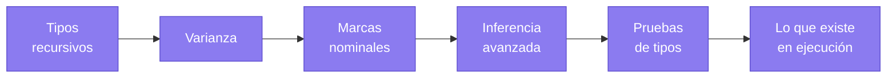
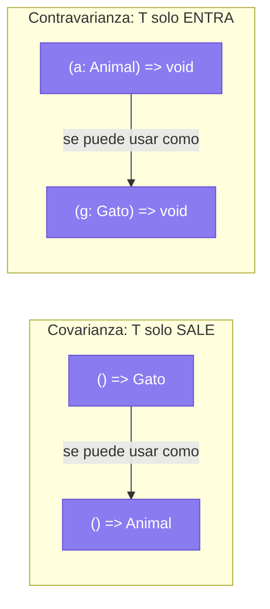

<div align="center">

# Nivel 4 · Experto

**Tipos recursivos, varianza, marcas nominales, inferencia avanzada, pruebas de tipos y lo que sobrevive en ejecución**

[⬅ Nivel 3 · Avanzado](3-avanzado.md) · [🏠 Inicio](../README.md) · [Nivel 5 · Arquitectura ➡](5-arquitectura.md)

</div>

> [!IMPORTANT]
> Ser experto en TypeScript no es saber escribir los tipos más complicados, sino saber **dónde está el límite**: qué garantiza el compilador, qué
> agujeros tiene a propósito, cuánto cuesta un tipo y qué queda de todo ello cuando el programa se ejecuta. Este nivel trata de esos límites.

| | |
|---|---|
| **Ejemplos** | 6 archivos en [`ejemplos/4-experto/`](../ejemplos/4-experto) |
| **Al terminar sabrás** | Escribir tipos recursivos dentro de los límites, razonar sobre varianza, simular tipos nominales y probar tus tipos |

---

## Mapa del nivel



---

## 1. Tipos recursivos

📄 [`01-tipos-recursivos.ts`](../ejemplos/4-experto/01-tipos-recursivos.ts)

```ts
type Json = string | number | boolean | null | Json[] | { [clave: string]: Json };

type Rutas<T> = T extends object
  ? { [K in keyof T & string]: T[K] extends object ? K | `${K}.${Rutas<T[K]>}` : K }[keyof T & string]
  : never;
// Rutas<typeof config>  →  'servidor' | 'servidor.puerto' | 'servidor.tls' | 'servidor.tls.activo' | …

type Invertir<T extends readonly unknown[], Acc extends unknown[] = []> =
  T extends readonly [infer P, ...infer R] ? Invertir<R, [P, ...Acc]> : Acc;   // recursión de cola
```

Los límites de recursión, **medidos** con los compiladores 5.9 y 7.0 invirtiendo tuplas de longitud creciente:

| Recursión | Funciona con | Falla con | Error |
|---|---|---|---|
| Fuera de cola (`[...R<Q>, P]`) | 48 elementos | 50 | TS2589 |
| En cola, con acumulador (`R<Q, [P, ...Acc]>`) | **999** | 1000 | TS2589 |

> [!NOTE]
> **Corrección de la primera edición.** El tipo `JSONValue` de la versión anterior olvidaba los **arreglos**: `[1, 2]` no era un JSON válido para
> él. El tipo de arriba los incluye.

---

## 2. Varianza

📄 [`02-varianza.ts`](../ejemplos/4-experto/02-varianza.ts)

Si `Gato` es un `Animal`, ¿un `Contenedor<Gato>` es un `Contenedor<Animal>`? Depende de cómo use el contenedor su parámetro.



| Varianza | Cuándo | Anotación explícita (4.7) |
|---|---|---|
| Covariante | `T` solo se devuelve | `interface Fuente<out T>` |
| Contravariante | `T` solo se recibe | `interface Sumidero<in T>` |
| Invariante | `T` entra y sale | `<in out T>` |
| Bivariante | Parámetros de **métodos** (por compatibilidad) | — |

> [!WARNING]
> **Corrección de la primera edición.** Su ejemplo de «contravarianza» mostraba que no se puede llamar a `honk()` sobre un `Vehicle`. Eso no es
> contravarianza, sino que un supertipo no tiene los miembros del subtipo. La contravarianza trata de los **parámetros de las funciones**: quien sabe
> atender a cualquier animal puede atender a un gato, pero no al revés.

El ejemplo termina con un agujero deliberado del sistema: los **arreglos son covariantes aunque se puedan escribir**, así que se puede meter un perro
en una lista de gatos a través de una referencia `Animal[]`, y el programa falla en ejecución.

---

## 3. Marcas: tipos nominales

📄 [`03-marcas-nominales.ts`](../ejemplos/4-experto/03-marcas-nominales.ts)

```ts
declare const marca: unique symbol;
type Marca<T, Nombre extends string> = T & { readonly [marca]: Nombre };

type IdPedido = Marca<string, 'IdPedido'>;
type Correo = Marca<string, 'Correo'>;

function correo(texto: string): Correo {
  if (!/^[^@\s]+@[^@\s]+\.[a-z]{2,}$/i.test(texto)) throw new Error(…);
  return texto.toLowerCase() as Correo;   // el único `as`, dentro del constructor que valida
}

cancelar(idUsuario, …);   // error: un IdUsuario no es un IdPedido, aunque ambos sean string
```

La marca no existe en ejecución —sigue siendo un `string`—, pero el compilador ya no confunde un identificador con otro, ni un texto sin validar con
un correo validado.

---

## 4. Inferencia avanzada

📄 [`04-inferencia-avanzada.ts`](../ejemplos/4-experto/04-inferencia-avanzada.ts)

Una «tienda» que deduce la firma de cada acción a partir de su implementación:

```ts
const tienda = crearTienda(
  { cuenta: 0, historial: [] as string[] },
  {
    sumar: (s, n: number) => ({ … }),
    renombrar: (s, etiqueta: string, veces: number) => ({ … }),
  },
);

tienda.despachar.sumar(5);                // (n: number) => void
tienda.despachar.renombrar('ok', 2);      // (etiqueta: string, veces: number) => void
```

Dos utilidades del oficio aparecen en el ejemplo: `UnionAInterseccion<U>`, que usa `infer` en posición contravariante, y `Simplificar<T>`, que
aplana intersecciones para que el editor las muestre legibles.

---

## 5. Probar los tipos

📄 [`05-pruebas-de-tipos.ts`](../ejemplos/4-experto/05-pruebas-de-tipos.ts) · 📄 [`_comun/pruebas-de-tipos.ts`](../ejemplos/_comun/pruebas-de-tipos.ts)

```ts
export type Igual<A, B> =
  (<T>() => T extends A ? 1 : 2) extends (<T>() => T extends B ? 1 : 2) ? true : false;
export type Afirmar<T extends true> = T;

type _Pruebas = [
  Afirmar<Igual<typeof textos, ('dos' | 'cuatro')[]>>,
  Afirmar<Igual<Igual<any, unknown>, false>>,   // la igualdad es exacta: any no es unknown
];

function _noCompila(): void {
  // @ts-expect-error: afirma que la línea siguiente NO compila
  particionar(mezcla, (x): x is boolean => typeof x === 'boolean');
}
```

Este repositorio entero se prueba así: **99 afirmaciones de tipos** (59 de igualdad exacta y 40 `@ts-expect-error`) que `tsc` comprueba en cada
compilación. Si un día una de ellas deja de cumplirse, la compilación falla.

> [!TIP]
> Fíjate en `function _noCompila()`: los tipos se borran, pero **el código no**. Una línea con `@ts-expect-error` en el nivel superior se ejecutaría
> igualmente. Envolverla en una función que nunca se llama mantiene la comprobación de tipos sin efectos en ejecución.

---

## 6. Lo que existe en ejecución

📄 [`06-reflexion-en-ejecucion.ts`](../ejemplos/4-experto/06-reflexion-en-ejecucion.ts)

| Existe en ejecución | No existe en ejecución |
|---|---|
| Clases, `instanceof`, `typeof`, `in`, símbolos | Interfaces, alias `type`, genéricos, uniones |
| `Symbol.hasInstance` (5.3: estrecha con su predicado) | Marcas, `readonly`, `private` (el de TypeScript) |
| Campos `#privados`, decoradores (transformados) | `satisfies`, `as`, `!` |
| Objetos `as const`, enums (que emiten código) | Las anotaciones de tipo |

```ts
class ConRuedas {
  static [Symbol.hasInstance](valor: unknown): valor is Vehiculo { … }
}
if (cosa instanceof ConRuedas) cosa.ruedas;   // el compilador entiende el predicado
```

---

## Retos

<details>
<summary><b>Reto 1.</b> Escribe <code>Ultimo&lt;T&gt;</code>: el tipo del último elemento de una tupla.</summary>

```ts
type Ultimo<T extends readonly unknown[]> = T extends readonly [...unknown[], infer U] ? U : never;
// Ultimo<[1, 2, 3]>  →  3
```

Funciona gracias a los elementos rest en cualquier posición de una tupla (TypeScript 4.2).

</details>

<details>
<summary><b>Reto 2.</b> Escribe <code>Aplanar&lt;T&gt;</code>, que aplane tuplas anidadas a cualquier profundidad, con recursión de cola.</summary>

```ts
type Aplanar<T extends readonly unknown[], Acc extends unknown[] = []> =
  T extends readonly [infer P, ...infer R]
    ? P extends readonly unknown[] ? Aplanar<R, [...Acc, ...Aplanar<P>]> : Aplanar<R, [...Acc, P]>
    : Acc;
// Aplanar<[1, [2, [3, 4]], 5]>  →  [1, 2, 3, 4, 5]
```

</details>

---

<div align="center">

[⬅ Nivel 3 · Avanzado](3-avanzado.md) · [🏠 Inicio](../README.md) · [Nivel 5 · Arquitectura ➡](5-arquitectura.md)

</div>
