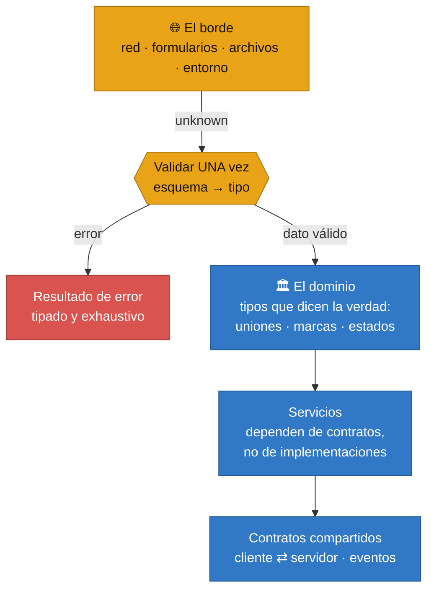
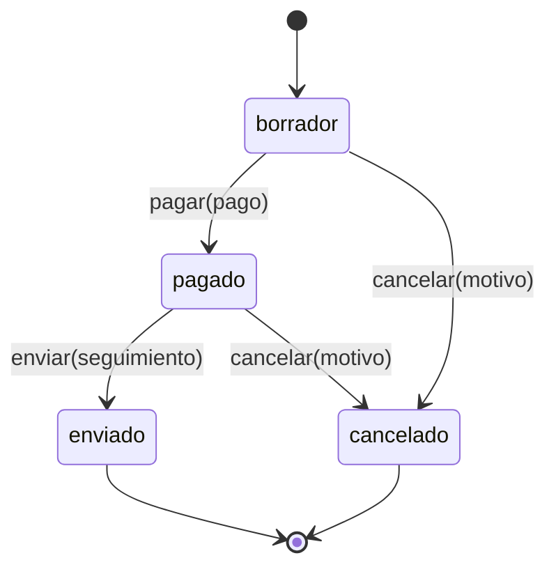
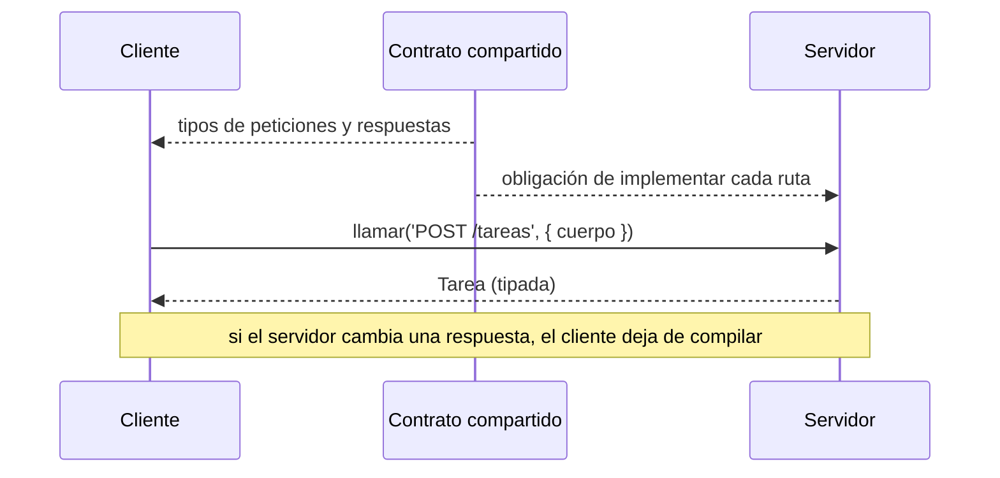

<div align="center">

# Nivel 5 · Arquitectura

**Diseñar sistemas con el compilador como aliado: errores como valores, estados imposibles, eventos tipados, inyección de dependencias, validación en el borde y contratos de extremo a extremo**

[⬅ Nivel 4 · Experto](4-experto.md) · [🏠 Inicio](../README.md) · [Nivel 6 · Arte ➡](6-arte.md)

</div>

> [!IMPORTANT]
> Los niveles anteriores enseñan a escribir tipos. Este enseña a **diseñar con ellos**. Un arquitecto de TypeScript no busca tipos ingeniosos, sino
> que el compilador vigile las reglas del sistema —qué estados existen, qué puede fallar, quién depende de quién, qué contrato une al cliente con el
> servidor— para que un cambio que rompe una regla falle **al escribirlo**, no en producción.

| | |
|---|---|
| **Ejemplos** | 6 archivos en [`ejemplos/5-arquitectura/`](../ejemplos/5-arquitectura) |
| **Al terminar sabrás** | Aplicar seis patrones que reparten la responsabilidad entre el compilador y el código en ejecución |

---

## Los principios



| # | Principio | Patrón del nivel |
|---|---|---|
| 1 | Lo que puede fallar forma parte de la firma | [Errores como valores](#1-errores-como-valores) |
| 2 | Los estados imposibles no se pueden representar | [Máquina de estados](#2-estados-imposibles-imposibles-de-representar) |
| 3 | Los módulos se comunican por contratos, no por suposiciones | [Eventos tipados](#3-un-bus-de-eventos-tipado) |
| 4 | Se depende de abstracciones, se inyecta la implementación | [Inyección de dependencias](#4-inyección-de-dependencias-sin-magia) |
| 5 | Se valida en el borde; dentro, los tipos dicen la verdad | [Validación en el borde](#5-validar-en-el-borde) |
| 6 | Un cambio de contrato rompe la compilación de ambos lados | [Contrato de extremo a extremo](#6-un-contrato-de-extremo-a-extremo) |

---

## 1. Errores como valores

📄 [`01-errores-como-valores.ts`](../ejemplos/5-arquitectura/01-errores-como-valores.ts)

`throw` es invisible en la firma: `function registrar(…): Cuenta` no dice que puede fallar, ni de cuántas formas. Un `Resultado` lo hace explícito.

```ts
type Resultado<T, E> = { ok: true; valor: T } | { ok: false; error: E };

type ErrorDeRegistro =
  | { tipo: 'correo-invalido'; correo: string }
  | { tipo: 'clave-debil'; motivos: string[] }
  | { tipo: 'ya-existe'; correo: string };

function registrar(correo: string, clave: string): Resultado<Cuenta, ErrorDeRegistro> { … }

function mensaje(e: ErrorDeRegistro): string {
  switch (e.tipo) {   // con noImplicitReturns, un tipo de error nuevo sin tratar no compila
    case 'correo-invalido': …
    case 'clave-debil': …
    case 'ya-existe': …
  }
}
```

| Usa `Resultado` para… | Usa `throw` para… |
|---|---|
| Errores **esperados** del dominio: validación, reglas de negocio, «no encontrado» | Errores **inesperados**: invariantes rotas, fallos de programación |
| Lo que quien llama debe tratar | Lo que solo puede tratar un manejador global |

---

## 2. Estados imposibles, imposibles de representar

📄 [`02-maquina-de-estados.ts`](../ejemplos/5-arquitectura/02-maquina-de-estados.ts)

```ts
// ✗ Un objeto con banderas admite combinaciones absurdas
interface PedidoMalo { pagado: boolean; enviado: boolean; cancelado: boolean; seguimiento?: string }

// ✓ Una unión discriminada solo admite los estados reales…
type Pedido =
  | { estado: 'borrador'; lineas: string[] }
  | { estado: 'pagado'; lineas: string[]; pago: string }
  | { estado: 'enviado'; lineas: string[]; pago: string; seguimiento: string }
  | { estado: 'cancelado'; motivo: string };

// …y una tabla tipada solo admite las transiciones válidas
type Transiciones = {
  borrador: 'pagado' | 'cancelado';
  pagado: 'enviado' | 'cancelado';
  enviado: never;
  cancelado: never;
};
```



`enviar(borrador, …)` y `cancelar(enviado, …)` son **errores de compilación**. El diagrama no es documentación aparte: es lo que dice el tipo
`Transiciones`.

---

## 3. Un bus de eventos tipado

📄 [`03-eventos-tipados.ts`](../ejemplos/5-arquitectura/03-eventos-tipados.ts)

```ts
interface EventosDeLaTienda {
  'carrito:añadido': { sku: string; cantidad: number };
  'pedido:pagado': { id: string; total: number };
  'sesion:cerrada': void;
}

const bus = new Bus<EventosDeLaTienda>();
bus.emit('carrito:añadido', { sku: 'TS-7', cantidad: 2 });   // ✓
bus.emit('carrito:vaciado');                                 // ✗ el evento no existe
bus.emit('sesion:cerrada', 'adiós');                         // ✗ un evento void no lleva carga

{
  using _s = bus.on('pedido:pagado', ({ id, total }) => …);  // la suscripción se libera al salir del bloque
}
```

El mapa de eventos es el **contrato** entre módulos que no se conocen, y `on` devuelve un `Disposable`: con `using`, olvidarse de cancelar una
suscripción deja de ser posible.

---

## 4. Inyección de dependencias sin magia

📄 [`04-inyeccion-de-dependencias.ts`](../ejemplos/5-arquitectura/04-inyeccion-de-dependencias.ts)

La primera edición inyectaba una interfaz a mano en un constructor. Sigue siendo la base. El paso siguiente es un contenedor con **tokens tipados**:

```ts
interface Token<T> { readonly id: symbol; readonly _tipo?: T }   // el tipo viaja en el token
const RELOJ = token<Reloj>('Reloj');
const SALUD = token<ServicioDeSalud>('ServicioDeSalud');

new Contenedor()
  .registrar(RELOJ, () => relojDelSistema)
  .registrar(SALUD, (c) => new ConsejosDeBienestar(c.resolver(RELOJ), c.resolver(REGISTRO)));

const r: Registro = c.resolver(RELOJ);   // ✗ el token de RELOJ produce un Reloj
```

| | Decoradores + `reflect-metadata` (Angular, NestJS) | Tokens tipados |
|---|---|---|
| Opciones del compilador | `experimentalDecorators`, `emitDecoratorMetadata` | Ninguna |
| Información de tipos en ejecución | Necesaria | No |
| Compatible con la eliminación de tipos de Node | No | Sí |
| Errores de cableado | En ejecución | En compilación |

En las pruebas basta con registrar un reloj falso: el ejemplo comprueba el consejo de las 8 h y el de las 17 h sin tocar el reloj del sistema.

---

## 5. Validar en el borde

📄 [`05-validacion-en-el-borde.ts`](../ejemplos/5-arquitectura/05-validacion-en-el-borde.ts)

Los tipos se borran en ejecución: lo que entra por la red no lo ha comprobado nadie. La solución es validar **una vez**, en el borde, con un
esquema del que se **deduce** el tipo:

```ts
const EsquemaUsuario = objeto({
  nombre: texto({ min: 2 }),
  edad: numero(),
  rol: literal('lector', 'editor', 'admin'),
  intereses: lista(texto()),
});
type Usuario = Inferir<typeof EsquemaUsuario>;
// { nombre: string; edad: number; rol: 'lector' | 'editor' | 'admin'; intereses: string[] }
// nadie escribió esta interfaz a mano: el esquema es la única fuente de verdad
```

El ejemplo implementa en unas 60 líneas lo esencial de Zod, Valibot o ArkType, para que se entienda cómo funcionan por dentro: cada validador es un
`Esquema<T>`, y `objeto` mapea sus campos con `Inferir`. En producción, usa una de esas bibliotecas (varias implementan la interfaz común
[Standard Schema](https://standardschema.dev)).

---

## 6. Un contrato de extremo a extremo

📄 [`06-contrato-de-extremo-a-extremo.ts`](../ejemplos/5-arquitectura/06-contrato-de-extremo-a-extremo.ts)

```ts
interface Contrato {
  'GET /tareas': { consulta: { hechas?: boolean }; respuesta: Tarea[] };
  'POST /tareas': { cuerpo: { titulo: string }; respuesta: Tarea };
  'PATCH /tareas/:id': { cuerpo: { hecha: boolean }; respuesta: Tarea | null };
}

const servidor: Implementacion = { … };   // TypeScript exige implementar todas las rutas, con sus tipos
await llamar('PATCH /tareas/:id', { id: '1', cuerpo: { hecha: true } });   // el `:id` de la ruta se deduce como parámetro
```



Es la idea de tRPC, ts-rest o Hono RPC. El valor arquitectónico es que **los errores de integración se mueven del día del despliegue al momento de
escribir el código**.

---

## La configuración del arquitecto

El [`tsconfig.json`](../tsconfig.json) de este repositorio es la base recomendada para un servicio en Node en 2026:

| Opción | Por qué |
|---|---|
| `strict` | El mínimo (y el valor por defecto desde TypeScript 6.0) |
| `noUncheckedIndexedAccess` | Un índice puede no existir |
| `exactOptionalPropertyTypes` | «Ausente» y «`undefined`» son cosas distintas, y en una API importa |
| `noImplicitOverride` · `noImplicitReturns` | Herencia y ramas explícitas |
| `verbatimModuleSyntax` | Lo que lleva `type` se borra; lo demás se emite tal cual: funciona con cualquier herramienta |
| `module: nodenext` · `target: es2024` | El runtime real, escrito explícitamente (desde la 6.0, `target` por defecto es flotante) |
| `types: ["node"]` | Desde la 6.0, `types` está vacío por defecto |

Las recetas para empaquetadores, bibliotecas y monorrepos están en el
[atlas, capítulo 17](https://github.com/CristianSifuentes/TypescriptLabs/blob/master/docs/17-tsconfig-de-referencia.md#2-recetas-para-2026).

---

## Retos

<details>
<summary><b>Reto 1.</b> Modela el estado de una petición asíncrona para que «cargando con error» sea imposible, y escribe una función que lo muestre.</summary>

```ts
type Carga<T, E = Error> =
  | { estado: 'inicial' }
  | { estado: 'cargando' }
  | { estado: 'listo'; datos: T }
  | { estado: 'fallo'; error: E };

function texto(c: Carga<string[]>): string {
  switch (c.estado) {
    case 'inicial': return '—';
    case 'cargando': return '…';
    case 'listo': return c.datos.join(',');
    case 'fallo': return c.error.message;
  }
}
```

</details>

<details>
<summary><b>Reto 2.</b> Escribe <code>mapear(resultado, f)</code>: aplica <code>f</code> al valor si es correcto y deja pasar el error si no.</summary>

```ts
function mapear<T, U, E>(r: Resultado<T, E>, f: (v: T) => U): Resultado<U, E> {
  return r.ok ? { ok: true, valor: f(r.valor) } : r;
}
```

`r` en la rama del error es `{ ok: false; error: E }`, que ya es un `Resultado<U, E>` válido: no hace falta reconstruirlo.

</details>

---

<div align="center">

[⬅ Nivel 4 · Experto](4-experto.md) · [🏠 Inicio](../README.md) · [Nivel 6 · Arte ➡](6-arte.md)

</div>
