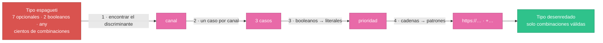

<div align="center">

# Nivel 6 · El arte de los tipos

**Tipos que se leen, mensajes de error propios, cómo desenredar un tipo espagueti y una pieza de exhibición: SQL tipado**

[⬅ Nivel 5 · Arquitectura](5-arquitectura.md) · [🏠 Inicio](../README.md)

</div>

> [!IMPORTANT]
> Un tipo se escribe una vez y se lee cientos: al pasar el cursor, en cada autocompletado, en cada mensaje de error. El arte de TypeScript no está
> en la complejidad, sino en lo que **experimenta quien usa tu código**: firmas que se entienden de un vistazo, errores que dicen qué hacer y reglas
> del negocio convertidas en la forma de los tipos. La complejidad, si hace falta, se queda dentro.

| | |
|---|---|
| **Ejemplos** | 4 archivos en [`ejemplos/6-arte/`](../ejemplos/6-arte) |
| **Al terminar sabrás** | Diseñar la experiencia de quien usa tus tipos, y reconocer y desenredar un tipo espagueti |

---

## El manifiesto

| | Espagueti | Desenredado |
|---|---|---|
| **Opcionales** | Todo es `?`: cualquier combinación compila | Una unión discriminada por cada caso real |
| **Booleanos** | `urgente?: boolean; silenciosa?: boolean` | `prioridad: 'silenciosa' \| 'normal' \| 'urgente'` |
| **`any`** | `datos?: any` | `unknown` en el borde, un tipo exacto dentro |
| **Cadenas** | `url: string` | `` url: `https://${string}` `` |
| **Identificadores** | `string` para todo | Marcas: `IdPedido`, `Correo` |
| **Errores** | Un `throw` invisible | Un `Resultado` con sus casos |
| **Lo que ve quien llama** | `A & B & Omit<C, 'x'>` | `{ id; nombre; creado }` |
| **Mensajes** | Una pantalla de tipos expandidos | «⛔ la etiqueta no puede tener espacios» |

---

## 1. Tipos que se leen

📄 [`01-tipos-que-se-leen.ts`](../ejemplos/6-arte/01-tipos-que-se-leen.ts)

```ts
type Simplificar<T> = { [K in keyof T]: T[K] } & {};

type ArticuloFeo = ConId & ConFechas & { titulo: string };   // al pasar el cursor: ConId & ConFechas & {…}
type Articulo = Simplificar<ArticuloFeo>;                    // al pasar el cursor: { id; creado; actualizado; titulo }

type Intervalo = [inicio: Date, fin: Date];                  // la tupla se documenta sola
type Alineacion = 'inicio' | 'centro' | 'fin';               // mejor que tres booleanos
```

Cuatro hábitos:

1. **Aplana lo que el usuario ve.** `Simplificar` convierte una intersección en un objeto legible al pasar el cursor.
2. **Nombra los conceptos.** Un alias con nombre aparece en los errores en lugar de su expansión.
3. **Etiqueta las tuplas.** `[inicio: Date, fin: Date]` dice lo que `[Date, Date]` calla.
4. **Usa uniones de literales, no banderas.** Tres booleanos admiten ocho combinaciones; casi nunca son válidas las ocho.

---

## 2. Mensajes de error propios

📄 [`02-mensajes-de-error-propios.ts`](../ejemplos/6-arte/02-mensajes-de-error-propios.ts)

Cuando una firma falla, el compilador muestra el tipo que esperaba. Así que se puede hacer que **el tipo esperado sea el mensaje**. Hay dos
técnicas, según lo que se valide.

**Literales de cadena: el mensaje sustituye al tipo.**

```ts
type EtiquetaValida<S extends string> =
  S extends '' ? '⛔ la etiqueta no puede estar vacía'
  : S extends `${string} ${string}` ? '⛔ la etiqueta no puede tener espacios'
  : S;

function definirEtiqueta<const S extends string>(nombre: EtiquetaValida<S>): `#${S}` { … }

definirEtiqueta('dos palabras');
// error TS2345: Argument of type '"dos palabras"' is not assignable to parameter of type
// '"⛔ la etiqueta no puede tener espacios"'.
```

**Objetos y tuplas: el mensaje se interseca.**

```ts
type Exigir<Condicion extends boolean, Mensaje extends string> = Condicion extends true ? unknown : Mensaje;

function emparejar<const A extends readonly unknown[], const B extends readonly unknown[]>(
  a: A,
  b: B & Exigir<Longitud<A> extends Longitud<B> ? true : false, `⛔ se esperaban ${Longitud<A>} elementos`>,
) { … }

emparejar(['a', 'b', 'c'], [1, 2]);
// error TS2345: … to parameter of type 'readonly [1, 2] & "⛔ se esperaban 3 elementos"'.
```

> [!WARNING]
> **La trampa que enseña este ejemplo.** La primera versión de este archivo usaba la intersección también con las cadenas, y el mensaje
> desaparecía: `"dos palabras" & "⛔ …"` son dos literales distintos, su intersección es `never`, y el error decía solo
> `parameter of type 'never'`. Los mensajes citados arriba son la salida real de TypeScript 7.0, no una reconstrucción.

---

## 3. Desenredar el espagueti

📄 [`03-desenredar-el-espagueti.ts`](../ejemplos/6-arte/03-desenredar-el-espagueti.ts)

El nombre del repositorio viene de aquí.

```ts
// ANTES: compila con cualquier combinación, incluida «SMS con email, urgente y silenciosa a la vez»
interface NotificacionEspagueti {
  tipo?: string; email?: string; telefono?: string; url?: string;
  urgente?: boolean; silenciosa?: boolean; datos?: any;
}

// DESPUÉS: cada canal exige exactamente lo suyo
type Notificacion =
  | { canal: 'correo'; para: `${string}@${string}`; asunto: string; prioridad: Prioridad }
  | { canal: 'sms'; para: `+${number}`; prioridad: Exclude<Prioridad, 'silenciosa'> }
  | { canal: 'webhook'; url: `https://${string}`; carga: Record<string, string | number> };
```



La receta en cuatro pasos sirve para cualquier tipo espagueti: **encontrar el discriminante, un caso por variante, booleanos a literales y cadenas
a patrones.**

---

## 4. Pieza de exhibición: SQL tipado

📄 [`04-sql-tipado.ts`](../ejemplos/6-arte/04-sql-tipado.ts)

El compilador **lee una consulta SQL** —una cadena— y deduce el tipo de cada fila:

```ts
const nombres = consultar('SELECT nombre, activo FROM usuarios');
//    { nombre: string; activo: boolean }[]

nombres[0]?.correo;                           // ✗ `correo` no se seleccionó
consultar('SELECT nombre FROM clientes');     // ✗ la tabla no existe
```

```ts
type Fila<Q extends string> =
  Q extends `SELECT ${infer Cols} FROM ${infer Tabla}`
    ? Recortar<Tabla> extends infer T extends keyof Esquema
      ? Recortar<Cols> extends '*'
        ? Esquema[T]
        : Columnas<Cols> extends infer C extends keyof Esquema[T] ? { [K in C]: Esquema[T][K] } : `⛔ columna desconocida en ${T}`
      : `⛔ tabla desconocida: ${Recortar<Tabla>}`
    : '⛔ se esperaba SELECT … FROM …';
```

No hay nada nuevo: plantillas literales (nivel 3), `infer` con restricción, recursión (nivel 4), tipos mapeados y mensajes de error propios (este
nivel). Es una demostración, no una biblioteca: muestra hasta dónde llega el sistema de tipos y por qué conviene **no** llevarlo siempre tan lejos.

> [!WARNING]
> Cada consulta se analiza al compilar, y en el editor, a cada pulsación. Con cientos de consultas largas, la comprobación se resiente. La regla
> del [atlas](https://github.com/CristianSifuentes/TypescriptLabs/blob/master/docs/15-programacion-a-nivel-de-tipos.md#10-rendimiento-y-cuándo-parar):
> la complejidad de un tipo se paga donde se define, no donde se usa, y si quien llama tiene que entenderla para usar la función, sobra.

---

## Retos

<details>
<summary><b>Reto 1.</b> Haz que <code>clave(s)</code> solo acepte literales: <code>clave('fijo')</code> compila y <code>clave(variableString)</code> da un error con mensaje propio.</summary>

```ts
type SoloLiteral<S extends string> = string extends S ? '⛔ pasa un literal, no un string cualquiera' : S;

function clave<const S extends string>(s: S & SoloLiteral<S>): S {
  return s;
}
```

`string extends S` solo es cierto cuando `S` es `string` en general, no un literal concreto.

</details>

<details>
<summary><b>Reto 2.</b> Desenreda: <code>{ tipo?: 'archivo' | 'url' | 'memoria'; ruta?: string; url?: string; cabeceras?: Record&lt;string, string&gt;; datos?: string }</code>.</summary>

```ts
type Origen =
  | { tipo: 'archivo'; ruta: string }
  | { tipo: 'url'; url: `https://${string}`; cabeceras?: Record<string, string> }
  | { tipo: 'memoria'; datos: string };
// const malo: Origen = { tipo: 'archivo', url: 'https://x.dev' };   // error
```

</details>

---

<div align="center">

**Has llegado al final de la guía.** Para profundizar en la historia y el porqué de cada característica, sigue con el
[TypeScript Atlas](https://github.com/CristianSifuentes/TypescriptLabs).

[⬅ Nivel 5 · Arquitectura](5-arquitectura.md) · [🏠 Inicio](../README.md)

</div>
